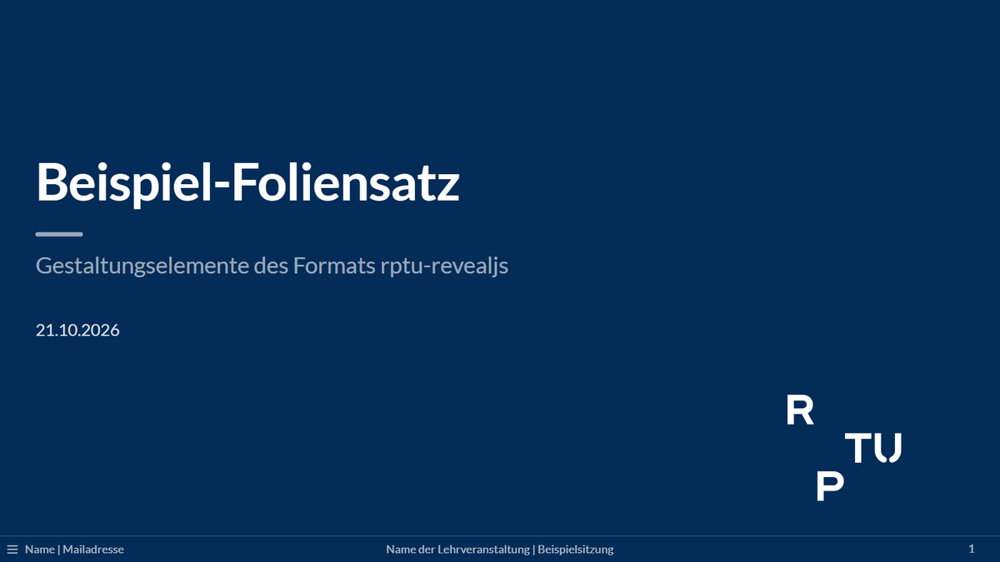
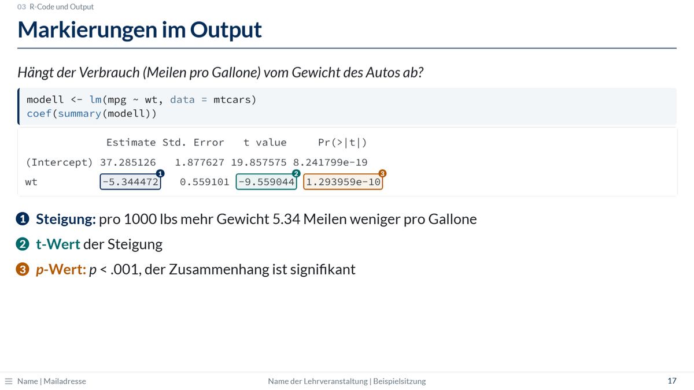

# quarto-teaching-slides: RPTU-Folien für Quarto (`rptu-revealjs`)

> **Herkunft:** Entwickelt von Dominik Vollbracht für die eigene Lehre an der RPTU
> (Rheinland-Pfälzische Technische Universität Kaiserslautern-Landau). Dies ist
> **kein offizielles Angebot der RPTU** und wird nicht von ihr herausgegeben.

> **English summary:** Developed by Dominik Vollbracht for his own teaching at RPTU
> (University of Kaiserslautern-Landau). **This is not an official RPTU product and is
> not published by RPTU.** A Quarto extension providing the slide format
> `rptu-revealjs` (reveal.js) in RPTU's corporate colours. Every `quarto render`
> produces the presentation as a single HTML file **and** a handout PDF without
> animations (printed with headless Chrome via the R package `chromote`) and reports
> slides whose content runs into the footer. Extras:
> numbered section slides, agenda slides, footer with contact / course / slide
> number, coloured highlights in R output (palette names or custom colour values via
> `highlight-roles:`, e.g. `fixed: "#3470A8"`), a course schedule table, an optional
> section label above slide titles (`section-indicator: true`), slides shown before
> the title slide (`.before-title`, e.g. a preparation slide while students arrive;
> slide numbers stay unchanged), and `.no-handout` for content that should only
> appear in the lecture. Class names are
> German with English aliases. Requires Quarto ≥ 1.7; the PDF additionally needs R
> with `chromote` and Google Chrome.
> **Documentation (currently German only):** <https://donvollb.github.io/quarto-teaching-slides/>.
> Code: MIT licence; fonts (SIL OFL 1.1), MathJax (Apache 2.0) and the RPTU logo/name are excluded, see
> [LICENSE](LICENSE).

## Was ist das?

Ein Folienformat für [Quarto](https://quarto.org)-Präsentationen im Design der RPTU,
entstanden in Übungen mit viel R-Code:

- **RPTU-Design:** Dunkelblau, Schrift Lato, nummerierte Abschnittsfolien, Fußzeile
  mit Kontakt, Veranstaltung und Foliennummer.
- **Vortrag und Handout aus einer Datei:** Jedes `quarto render` erzeugt den Vortrag
  als HTML-Datei und ein Handout als PDF (ohne schrittweise Einblendungen und ohne `.no-handout`).
  Zu volle Folien meldet das Rendern.
- **Für Übungen mit R:** Markierungen im R-Output, Agenda, Kästen, Warndreieck für
  Output-Folien, KI-Symbol, Semesterplan.
- **Für den Vortrag:** Folien vor der Titelfolie (`.vor-titel`), z. B. zur Vorbereitung,
  während die Studierenden ankommen; auf Wunsch der aktuelle Abschnitt über jedem
  Folientitel.
- Deutsche Klassennamen mit englischen Aliassen (z. B. `.kasten` = `.info-box`).

<p>
  
  
</p>

**Dokumentation, Bilder und Demo:** <https://donvollb.github.io/quarto-teaching-slides/>
(auf Deutsch).

## Schnellstart

Voraussetzungen: Quarto ≥ 1.7; für das PDF zusätzlich R mit dem Paket `chromote` und
Google Chrome (ohne Chrome geht auch „Chrome for Testing“, siehe Website, Installation).

Neues Projekt, z. B. für eine Lehrveranstaltung (in einem leeren Ordner):

```bash
quarto use template donvollb/quarto-teaching-slides
```

Dann in `_quarto.yml` den Kontakt eintragen und rendern:

```bash
quarto render
```

Bestehendes Projekt:

```bash
quarto add donvollb/quarto-teaching-slides
```

und in dessen `_quarto.yml`:

```yaml
project:
  post-render: _extensions/donvollb/rptu/post-render.R

kontakt: "Vorname Nachname | vorname.nachname@rptu.de"
```

Ein Foliensatz braucht im Kopf `format: rptu-revealjs`. Ein vollständiges Beispiel mit
allen Elementen ist [`template.qmd`](template.qmd). Alles Weitere (Folien gestalten,
Handout, Markierungen, Semesterplan, Design, FAQ) steht auf der
[Website](https://donvollb.github.io/quarto-teaching-slides/de/). Änderungen der
einzelnen Versionen: [NEWS.md](NEWS.md).

## Inhalt des Repositorys

| Pfad | Inhalt |
|------|--------|
| `_extensions/rptu/` | die Extension (Format `rptu-revealjs`, Filter, Theme, post-render-Skript) |
| `_quarto.yml`, `_rptu-post-render.R`, `template.qmd`, `_resources/` | Projektvorlage für `quarto use template` |
| `website/` | Quellen der Tutorial-Website (eigenes Quarto-Projekt) |
| `docs/` | fertig gerenderte Website (GitHub Pages) |

## Lizenz

Der Code steht unter der **MIT-Lizenz**, Copyright (c) 2026 Dominik Vollbracht, siehe
[LICENSE](LICENSE). **Ausgenommen** sind:

- die **Schriften Lato und Source Code Pro**: SIL Open Font License 1.1, Lizenztexte in
  [`_extensions/rptu/fonts/`](_extensions/rptu/fonts/);
- **MathJax** (für Formeln ohne Internet): Apache License 2.0, Lizenztext in
  [`_extensions/rptu/mathjax/`](_extensions/rptu/mathjax/);
- das **RPTU-Logo sowie Name und Marke „RPTU“**: Die Rechte liegen bei der RPTU. Die
  RPTU stellt das Logo auf ihrer
  [Corporate-Design-Seite](https://rptu.de/ueber-die-rptu/organisation/referate/universitaetskommunikation/rptu-corporate-design)
  bereit, ohne ausdrückliche Nutzungsbedingungen. Fragen zum Corporate Design an die
  Universitätskommunikation der RPTU (presse@rptu.de). Wer das Format außerhalb der
  RPTU nutzt, sollte das Logo ersetzen oder abschalten (siehe Website, Design anpassen).
