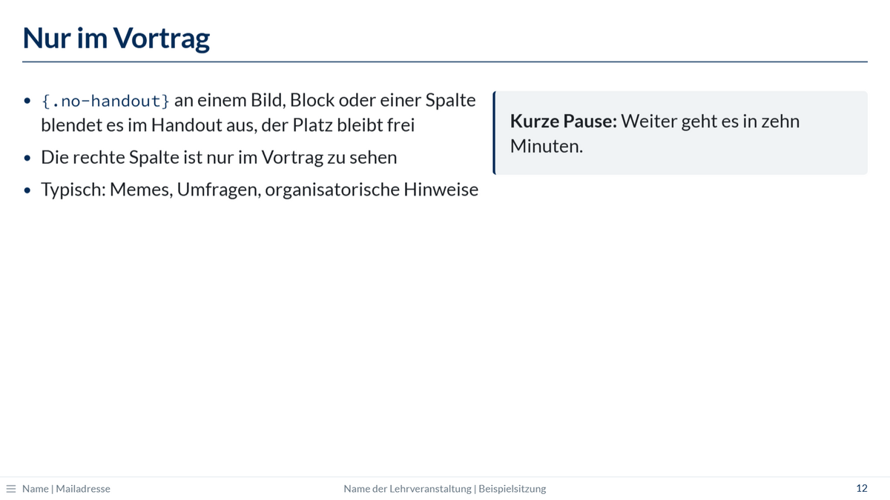
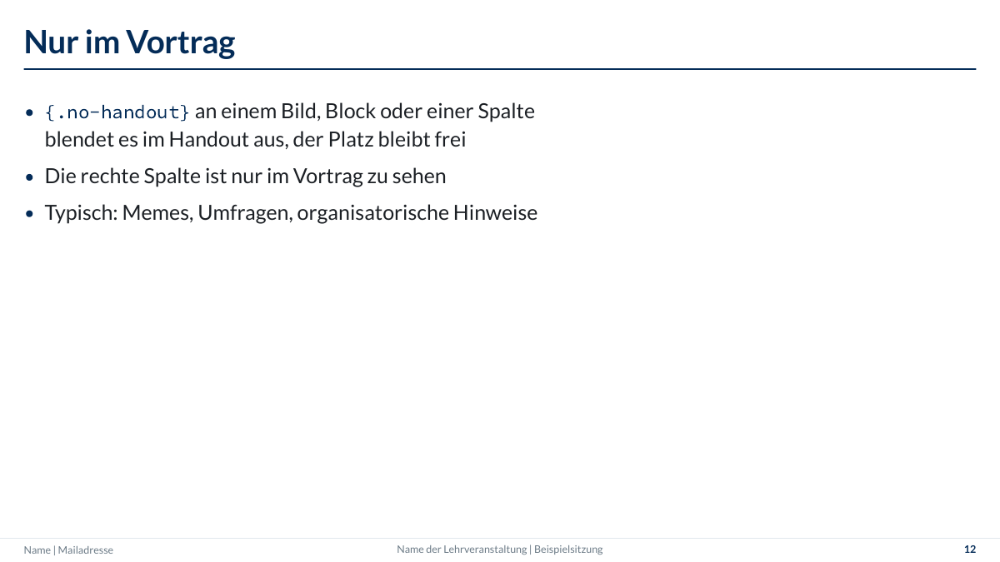

## Was entsteht

Jedes Rendern erzeugt zu `folien.qmd` zwei Dateien:

| Datei | Inhalt | Zweck |
|-------|--------|-------|
| `folien.html` | alles, mit schrittweisen Einblendungen | Vortrag: eine einzige Datei, auch ohne Internet nutzbar |
| `folien.pdf` | alle Inhalte sofort sichtbar, ohne Inhalte nur für den Vortrag | Handout, z. B. zum Hochladen in die Lernplattform |

Beide Versionen zeigt die [Demo](demo.qmd). Fehlt das Handout, hilft
[Probleme und FAQ](faq.qmd#kein-pdf) weiter. Beim Arbeiten an den Folien geht es
[ohne Handout](getting-started.qmd#ohne-handout) schneller.

## Nur im Vortrag zeigen {#no-handout}

Manches gehört nur in den Raum: Memes, Umfragen, organisatorische Hinweise. Die Klasse
`.no-handout` blendet es im Handout aus.

```markdown
{.no-handout}

::: {.no-handout}
**Kurze Pause:** Weiter geht es in zehn Minuten.
:::

## Umfrage {.no-handout}
```

| Wo | Wirkung im Handout |
|----|--------------------|
| an einem Bild | Bild unsichtbar, sein Platz bleibt frei |
| an einem Block (`::: {.no-handout}`) | Block unsichtbar, Platz bleibt frei |
| an einer Spalte (`::: {.column width="40%" .no-handout}`) | Spalte unsichtbar, Platz bleibt frei |
| an einer Folie (`## Titel {.no-handout}`) | ganze Folie entfällt |
| an einer Abschnittsfolie (`# Titel {.no-handout}`) | Abschnittsfolie entfällt; die Nummern der folgenden Abschnitte rücken im Handout auf |

Weil der Platz frei bleibt, sieht jede Folie in beiden Versionen gleich aus:

::: {.grid}
::: {.g-col-12 .g-col-md-6}
{.folienbild}
:::
::: {.g-col-12 .g-col-md-6}
{.folienbild}
:::
:::

## Was im Handout anders ist

- **Schrittweise Einblendungen** (`. . .`, `::: incremental`, `::: fragment`): Im
  Handout erscheinen alle Inhalte sofort.
- **Foliennummern:** Sie entsprechen denen im Vortrag. Entfällt eine Folie, springt die
  Nummer im Handout (z. B. von 10 auf 12). So passt ein Verweis wie „siehe Folie 12“
  zu beiden Versionen.
- **[Sprechernotizen](slides.qmd#sprechernotizen)** erscheinen nur in der
  Referentenansicht des Vortrags, nicht im Handout.
- **Zufallszahlen:** Der R-Code läuft für das Handout ein zweites Mal. Damit beide
  Versionen dieselben Zahlen zeigen, im Setup-Chunk `set.seed()` setzen.

## Wie es funktioniert

Nach dem normalen Rendern startet Quarto das post-render-Skript der Extension
(`post-render.R`). Für jeden Foliensatz

1. rendert es die Datei ein zweites Mal mit `-M handout:true`; dabei löst der Filter
   `handout.lua` die schrittweisen Einblendungen auf, blendet Inhalte mit
   `.no-handout` aus und entfernt Folien mit `.no-handout`,
2. druckt diese Fassung mit Chrome als PDF und
3. löscht die Zwischendatei `folien_handout.html` wieder.

Außerdem entfernt es aus den HTML-Dateien eine Schrift, die Quarto einbindet, die
Folien aber nicht nutzen (ca. 3 MB weniger pro Datei). Enthält ein Foliensatz Formeln,
bettet es die Software für Formeln (MathJax) ein, die Quarto sonst beim Präsentieren
aus dem Internet lädt (ca. 3 MB mehr).
