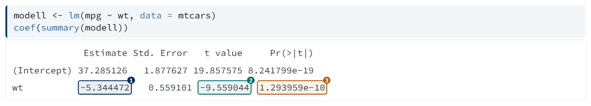
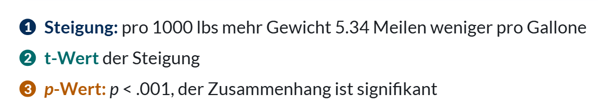
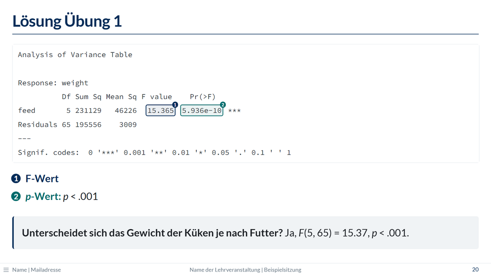

{.folienbild width="80%"}

## So geht's

Den Chunk in einen Block mit der Klasse `.markiert` einpacken. In `m1`, `m2`, … steht
jeweils der Text, der im Output eingerahmt werden soll:

````markdown
::: {.markiert m1="-5.344472" m2="-9.559044" m3="1.293959e-10"}
```{{r}}
modell <- lm(mpg ~ wt, data = mtcars)
coef(summary(modell))
```
:::

. . .

- [1]{.nr} **Steigung:** pro 1000 lbs mehr Gewicht 5.34 Meilen weniger pro Gallone
- [2]{.nr} **t-Wert** der Steigung
- [3]{.nr} ***p*-Wert:** *p* < .001, der Zusammenhang ist signifikant
````

{.folienbild}

`[1]{.nr}` setzt in der Erklärung die passende Nummer. Am Anfang eines Listenpunkts
ersetzt sie den Aufzählungspunkt, und Fettes direkt danach erscheint in derselben
Farbe.

{.folienbild width="70%"}

## Arbeitsablauf

1. Den Chunk zuerst ohne Markierung rendern.
2. Die Zahlen aus dem Output kopieren, genau so, wie R sie ausgibt (auch mit
   Leerzeichen, z. B. `"X-squared = 293.37"`).
3. Den Chunk in `::: {.markiert m1="…"}` einpacken und die Erklärung schreiben.
4. Die Erklärung mit `. . .` erst nach dem Output einblenden: erst schauen, dann
   erklären.

## Regeln

- Gesucht wird der Text **wörtlich**, markiert wird sein **erstes** Vorkommen im
  Output. Erzeugt der Chunk mehrere Outputs, gilt das für jeden einzeln.
- Steht eine Stelle nicht im Output (z. B. weil sich Zahlen geändert haben), warnt das
  Rendern:
  `WARNUNG (markieren.lua): Markierung m2 "…" nicht im Output gefunden`.
- Überlappen sich zwei Stellen, bleibt die im Output weiter hinten stehende ohne
  Rahmen.
- Die Farben: 1 Dunkelblau, 2 Dunkelgrün, 3 Orange, 4 Violett, 5 Pink, 6 Blaugrau.
  Ab der siebten Markierung wiederholen sie sich (7 wie 1, 8 wie 2 usw.). Andere
  Farben: siehe [Farben selbst wählen](#farben).
- Markierungen funktionieren auch mit `#| echo: false` (nur Output).
- Markierter Output hat mehr Zeilenabstand, damit die Nummern Platz haben. Langer
  Output passt dann eventuell nicht mehr mit Erklärung auf eine Folie; dann nur den
  nötigen Teil ausgeben, siehe [Breiter Output](r-code.qmd#breiter-output).

## Farben selbst wählen {#farben}

Normalerweise hängt die Farbe an der Nummer: `m1` ist dunkelblau, `m2` dunkelgrün
usw. Soll ein Begriff über mehrere Folien dieselbe Farbe behalten, z. B. der
Achsenabschnitt immer grün wie in einer Grafik, legt `farben=` die Farben der Reihe
nach fest:

````markdown
::: {.markiert m1="-5.344472" m2="37.285126" farben="navy gruen"}
```{{r}}
coef(summary(modell))
```
:::

- [1]{.nr} **Steigung**
- [2]{.nr} **Achsenabschnitt**
````

- Der erste Name färbt `m1`, der zweite `m2` usw. Fehlen Namen, behalten die übrigen
  Markierungen ihre Standardfarbe.
- Die Nummern `[1]{.nr}` und der Fettdruck danach übernehmen diese Farben bis zur
  nächsten Folie. Stehen zwei markierte Blöcke auf einer Folie, gilt für jede Nummer
  der letzte Block davor.
- Englischer Name des Attributs: `colors=`.

**Farbnamen:** `navy` (Dunkelblau), `hellblau`, `blaugrau`, `petrol` (Grüngrau), `teal`
(Dunkelgrün), `gruen` (wie `.gruen`), `orange`, `violett`, `pink`, `rot` (wie `.rot`),
`grau`. Die Namen entsprechen `rptu_farben` für [Grafiken](r-code.qmd#grafiken);
Orange ist für Rahmen und Schrift etwas dunkler.

### Farbrollen

Wer dieselben Begriffe in vielen Foliensätzen markiert, kann ihnen in der `_quarto.yml`
(oder im Kopf eines Foliensatzes) einmal eine Farbe zuordnen:

```yaml
markierung-rollen:
  intercept: gruen
  slope: navy
```

Danach geht `farben="slope intercept"`. Englischer Name: `highlight-roles:`. Ein
unbekannter Name führt beim Rendern zu einer Warnung, die Markierung behält dann ihre
Standardfarbe:
`WARNUNG (markieren.lua): unbekannte Farbe oder Rolle "…" in farben= (m1 bleibt in der Standardfarbe)`.

Statt eines Farbnamens geht in den Rollen auch ein eigener Farbwert, z. B. passend zu
einer Grafik:

```yaml
markierung-rollen:
  intercept: gruen
  fixed: "#3470A8"
```

- Der Farbwert braucht Anführungszeichen, sonst liest YAML ihn als Kommentar. Möglich
  sind sechs- und dreistellige Werte (`"#3470A8"`, `"#37A"`).
- Rahmen, heller Hintergrund, Nummer und Fettdruck sehen aus wie bei den Farbnamen.
  Bei hellen Farben wird die Nummer automatisch dunkel statt weiß gesetzt.
- Helle Farben sind als Schrift und am Beamer schlecht lesbar; kräftige, eher dunkle
  Töne funktionieren am besten.
- Eigene Farbwerte gibt es nur über Rollen, nicht direkt in `farben=`.

## Übungsfolge {#uebungsfolge}

Ein bewährter Ablauf für Übungen mit R, über drei Folien:

1. **Übungsfolie:** Fragestellung, Datensatz und Aufgaben; eine Zusatzaufgabe mit KI
   bekommt `{.ki}`.
2. **Output-Folie** mit `{.achtung}`: nur der Output (`#| echo: false`), damit die
   Studierenden ihr Ergebnis vergleichen können. Das Warndreieck sagt: noch nicht
   weiterklicken.
3. **Lösungsfolie:** markierter Output, Erklärung und die Antwort im Kasten.

````markdown
## Übung 1

**Datensatz:** *chickwts* (in R enthalten)\
**Fragestellung:** [Unterscheidet sich das Gewicht der Küken je nach Futter?]{.frage}

### Aufgaben

1. Verschaffen Sie sich einen Überblick über den Datensatz.
2. Berechnen Sie eine einfaktorielle Varianzanalyse.

### Zusatzaufgabe {.ki}

- Lassen Sie sich von einer KI R-Code für eine passende Grafik erzeugen.

## Output Übung 1 {.achtung}

```{{r}}
#| echo: false
anova(lm(weight ~ feed, data = chickwts))
```

## Lösung Übung 1

::: {.markiert m1="15.365" m2="5.936e-10"}
```{{r}}
#| echo: false
anova(lm(weight ~ feed, data = chickwts))
```
:::

- [1]{.nr} **F-Wert**
- [2]{.nr} ***p*-Wert:** *p* < .001

. . .

::: kasten
**Unterscheidet sich das Gewicht der Küken je nach Futter?** Ja, *F*(5, 65) = 15.37, *p* < .001.
:::
````

{.folienbild width="70%"}
