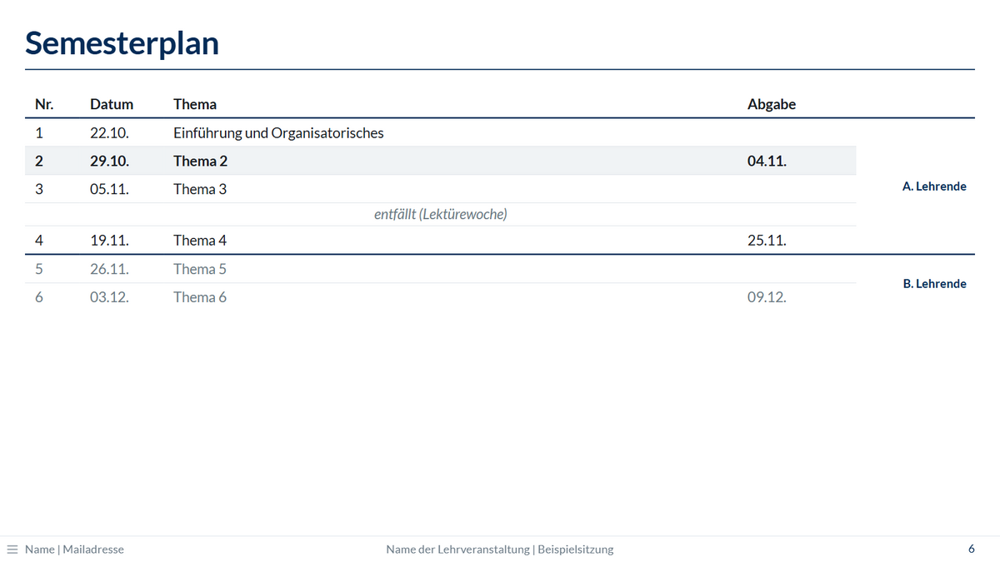

{.folienbild width="80%"}

Der Semesterplan wird **einmal** als Tabelle angelegt und in jeden Foliensatz
eingebunden. Pro Sitzung ändert sich nur eine Zahl: Sie bestimmt, welche Sitzung
**fett und leicht getönt** hervorgehoben wird.

## 1. Tabelle anlegen

Die Vorlage bringt ein Beispiel mit:
[`_resources/semesterplan.qmd`](https://github.com/donvollb/quarto-teaching-slides/blob/main/_resources/semesterplan.qmd).
Weil der Ordnername `_resources/` mit einem Unterstrich beginnt, rendert Quarto ihn
nicht; die Datei dient nur zum Einbinden.

Die Tabelle ist in HTML geschrieben, weil jede Zeile eine eigene Klasse braucht; eine
Markdown-Tabelle kann das nicht. Jede Sitzung ist eine Zeile `<tr class="sN">` mit
ihrer Nummer N:

````markdown
```{=html}
<table>
  <thead>
    <tr><th>Nr.</th><th>Datum</th><th>Thema</th><th>Abgabe</th><th></th></tr>
  </thead>
  <tbody>
    <tr class="s1"><td>1</td><td>22.10.</td><td>Einführung</td><td></td>
      <td class="person" rowspan="3">A. Lehrende</td></tr>
    <tr class="s2"><td>2</td><td>29.10.</td><td>Thema 2</td><td>04.11.</td></tr>
    <tr class="pause"><td colspan="4">entfällt (Lektürewoche)</td></tr>
    <tr class="s3 wechsel teil2"><td>3</td><td>12.11.</td><td>Thema 3</td><td></td>
      <td class="person">B. Lehrende</td></tr>
  </tbody>
</table>
```
````

| Klasse | Wirkung |
|--------|---------|
| `s1`, `s2`, … an `<tr>` | Zeile der Sitzung 1, 2, …; hervorgehoben werden können Sitzungen 1 bis 20 |
| `pause` an `<tr>` | kursiv und zentriert, z. B. für Ferien (eine Zelle mit `colspan`) |
| `wechsel` an `<tr>` | Linie über der Zeile, z. B. beim Wechsel der Lehrperson |
| `teil2` an `<tr>` | ausgegraut, z. B. Sitzungen einer anderen Lehrperson |
| `person` an `<td>` | Name rechts, mit `rowspan` über mehrere Zeilen |

## 2. Auf einer Folie einbinden

```markdown
## Semesterplan

::: {.semesterplan aktuell="2"}

:::
```

- `aktuell="2"` hebt die Zeile `s2` hervor. In der nächsten Sitzung steht hier `3`.
- Der Pfad ist relativ zur qmd-Datei; hier liegt sie in einem Unterordner.

::: {.callout-warning}
Den `include`-Befehl nie in einen Kommentar der eingebundenen Datei selbst schreiben:
Sie würde sich dann endlos selbst einbinden.
:::
