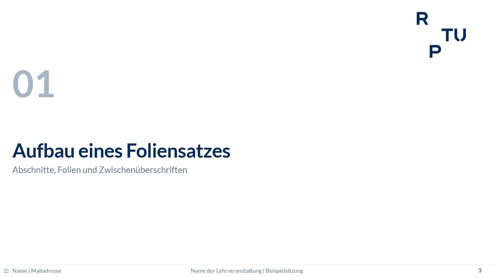
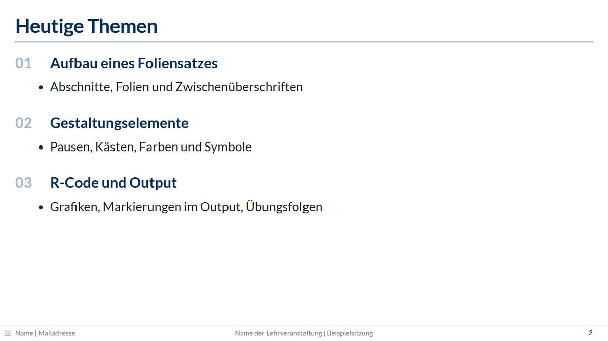
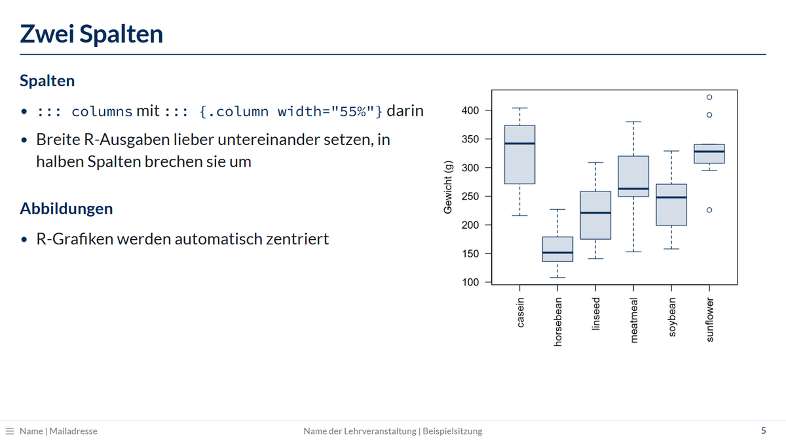
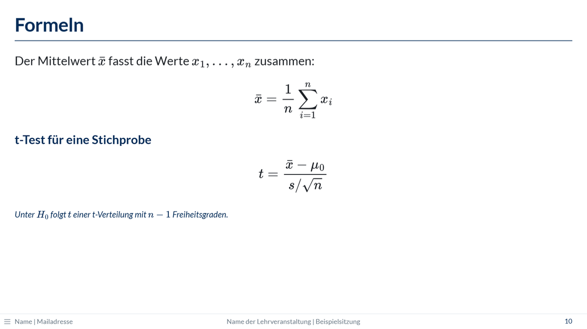
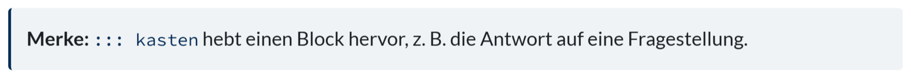
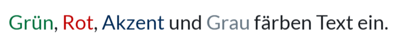
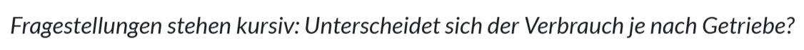
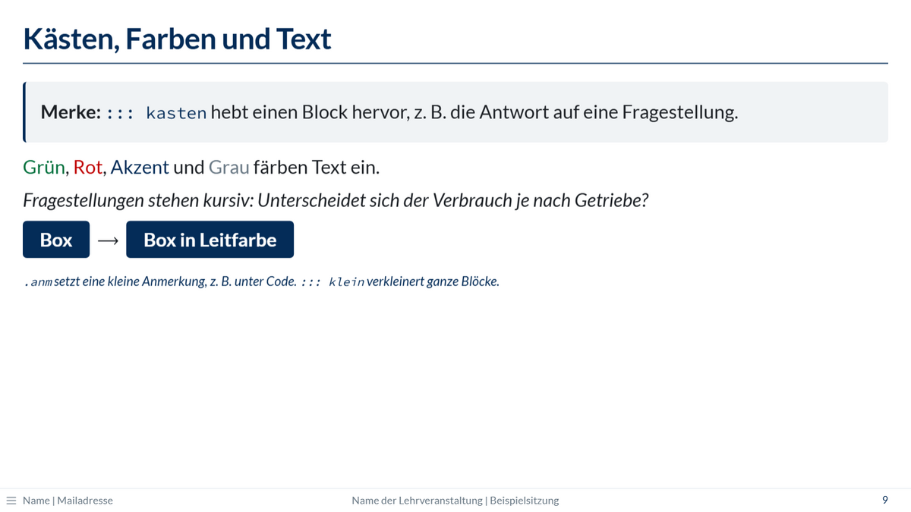
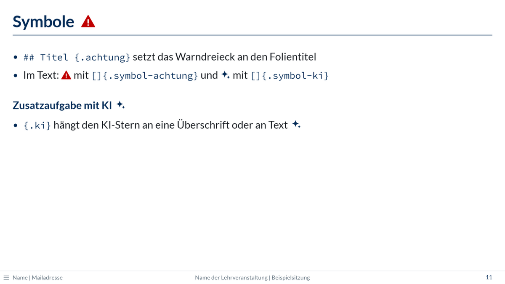

Zu jedem Element gibt es hier kopierbaren Code und ein Bild. Alle Klassen auf einen
Blick, auch mit ihren englischen Namen, stehen in der [Referenz](reference.qmd#klassen).

## Abschnitte

```markdown
# Deskriptive Statistik

Lage- und Streuungsmaße
```

`# Titel` erzeugt eine Abschnittsfolie mit großer Nummer und Logo. Die Abschnitte
werden fortlaufend nummeriert (01, 02, …). Text direkt unter der Überschrift wird zum
grauen Untertitel.

{.folienbild width="70%"}

Eine Nummer lässt sich auch selbst setzen, z. B. `# Rückblick {nr="00"}`. Die
fortlaufende Zählung der übrigen Abschnitte ändert sich dadurch nicht.

## Agenda

```markdown
## Heutige Themen {.agenda}

### Deskriptive Statistik

- Lage- und Streuungsmaße

### Grafiken mit ggplot2
```

`{.agenda}` nummeriert die `###`-Überschriften dieser Folie (01, 02, …). Listen und
Text darunter werden passend eingerückt.

{.folienbild width="70%"}

## Folien und Zwischenüberschriften

```markdown
## Ablauf der Sitzungen

### Theorie

- Inhalte wiederholen und vertiefen

### Praxis

- Verfahren in R anwenden
```

`## Titel` beginnt eine neue Folie mit Titellinie, `###` setzt eine fette
Zwischenüberschrift.

## Zwei Spalten

````markdown
## Zwei Spalten

::: columns
::: {.column width="55%"}
### Links

- Text oder Code
:::

::: {.column width="45%"}
```{{r}}
#| echo: false
boxplot(weight ~ feed, data = chickwts)
```
:::
:::
````

Jede Spalte ist ein eigener Block in `::: columns`. Die Breiten sollten zusammen
höchstens 100 % ergeben. Jeder Block endet mit `:::`; ein fehlendes `:::` verschiebt
den Rest der Folie in die Spalte.

{.folienbild width="70%"}

Breiter R-Output gehört nicht in halbe Spalten, siehe
[Breiter Output](r-code.qmd#breiter-output).

## Bilder

```markdown
{width="60%"}
```

Bilder werden wie in jedem Quarto-Dokument eingebunden; der Pfad gilt relativ zur
qmd-Datei. Mehr Möglichkeiten stehen in der
[Quarto-Dokumentation](https://quarto.org/docs/presentations/revealjs/#images).

## Formeln

```markdown
Der Mittelwert $\bar{x}$ ist definiert als

$$\bar{x} = \frac{1}{n} \sum_{i=1}^{n} x_i$$
```

Formeln werden in LaTeX geschrieben: zwischen `$…$` im Text, zwischen `$$…$$` als
eigene Zeile. Sie funktionieren auch ohne Internetverbindung, denn die Software für
Formeln (MathJax) wird eingebettet. Ein Foliensatz mit Formeln wird dadurch etwa 3 MB
größer.

{.folienbild width="70%"}

## Schrittweise Einblendungen

```markdown
Sofort sichtbar.

. . .

Erscheint beim nächsten Klick.

::: incremental
- Punkt für Punkt
- erscheint diese Liste
:::

::: fragment
Dieser Block erscheint als Ganzes beim Klick.
:::
```

- `. . .` auf einer eigenen Zeile ist eine Pause: Alles danach erscheint beim nächsten
  Klick. Das funktioniert auch nach `###`-Überschriften und in Spalten.
- `::: incremental` blendet eine Liste Punkt für Punkt ein, `::: fragment` einen ganzen
  Block.
- Im Handout erscheinen alle Inhalte sofort.

## Sprechernotizen

```markdown
## Ergebnisse

- Mittelwert und Streuung

::: notes
Auf die Ausreißer in Gruppe B hinweisen.
:::
```

Sprechernotizen erscheinen nur in der Referentenansicht (Taste `S`), nicht auf der
Folie und nicht im Handout.

## Kasten

```markdown
::: kasten
**Merke:** Ein Kasten hebt einen Block hervor, z. B. die Antwort auf eine
Fragestellung.
:::
```

{.element}

## Text hervorheben

```markdown
[Grün]{.gruen}, [Rot]{.rot}, [Akzent]{.akzent} und [Grau]{.grau}

[Unterscheidet sich der Verbrauch je nach Getriebe?]{.frage}

Ein wichtiges [Wort]{.box} im Satz

[Kleine Anmerkung, z. B. unter Code]{.anm}
```

| Klasse | Wirkung |
|--------|---------|
| `.gruen`, `.rot`, `.akzent`, `.grau` | Textfarbe. Grün und Rot sind bewusst dunkel, weil Beamer Farben aufhellen |
| `.frage` | kursiv, für Fragestellungen |
| `.box` | weiße, fette Schrift auf dunkelblauem Grund, für einzelne Wörter |
| `.anm` | kleine, kursive Anmerkung in Dunkelblau |

{.element}

{.element}

{.element}

Einen ganzen Block in kleinerer Schrift setzt `::: klein`.

{.folienbild width="70%"}

## Symbole

```markdown
## Output Übung 1 {.achtung}

### Zusatzaufgabe mit KI {.ki}

Im Text: []{.symbol-achtung} und []{.symbol-ki}
```

- `{.achtung}` setzt ein rotes Warndreieck hinter den Folientitel. Gedacht ist es für
  Output-Folien in einer [Übungsfolge](highlighting.qmd#uebungsfolge).
- `{.ki}` setzt einen KI-Stern hinter eine Überschrift oder ein Stück Text, z. B. für
  Zusatzaufgaben mit KI.
- `[]{.symbol-achtung}` und `[]{.symbol-ki}` setzen das Symbol allein in den Text.

{.element}

{.element}

{.folienbild width="70%"}
